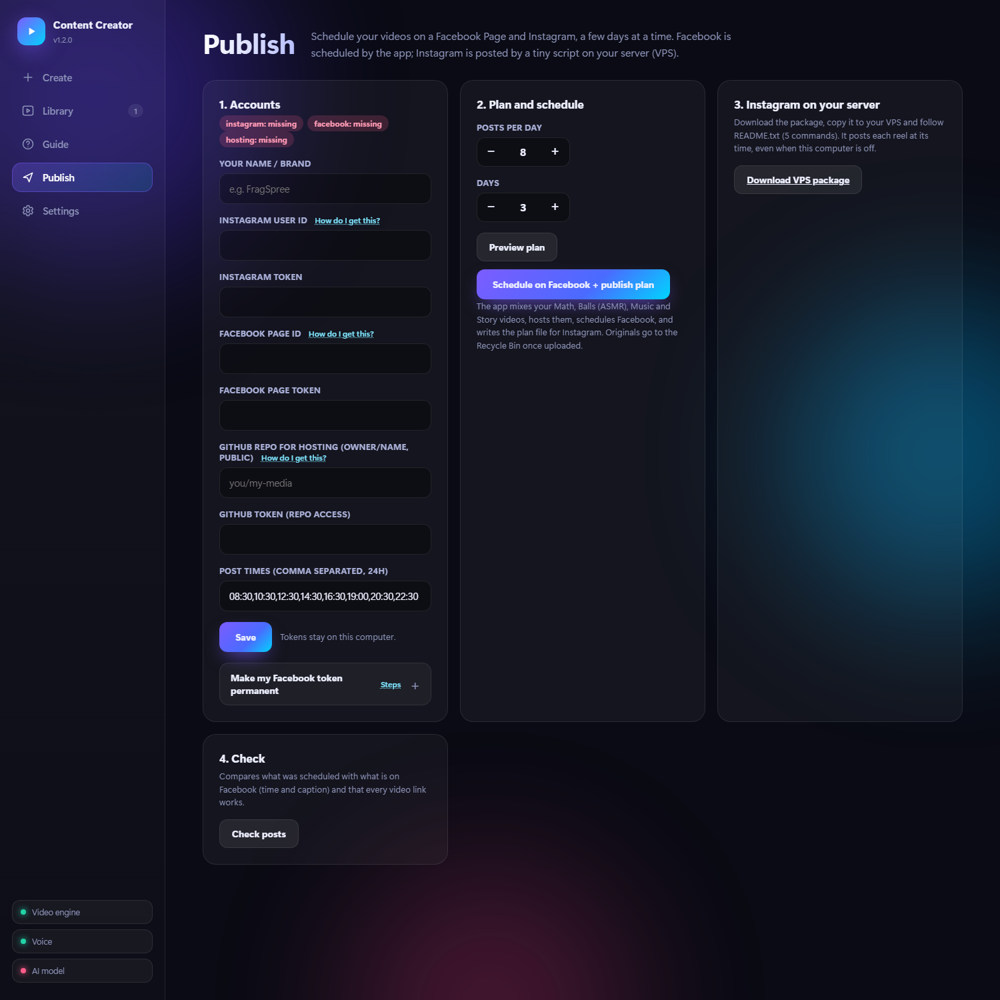
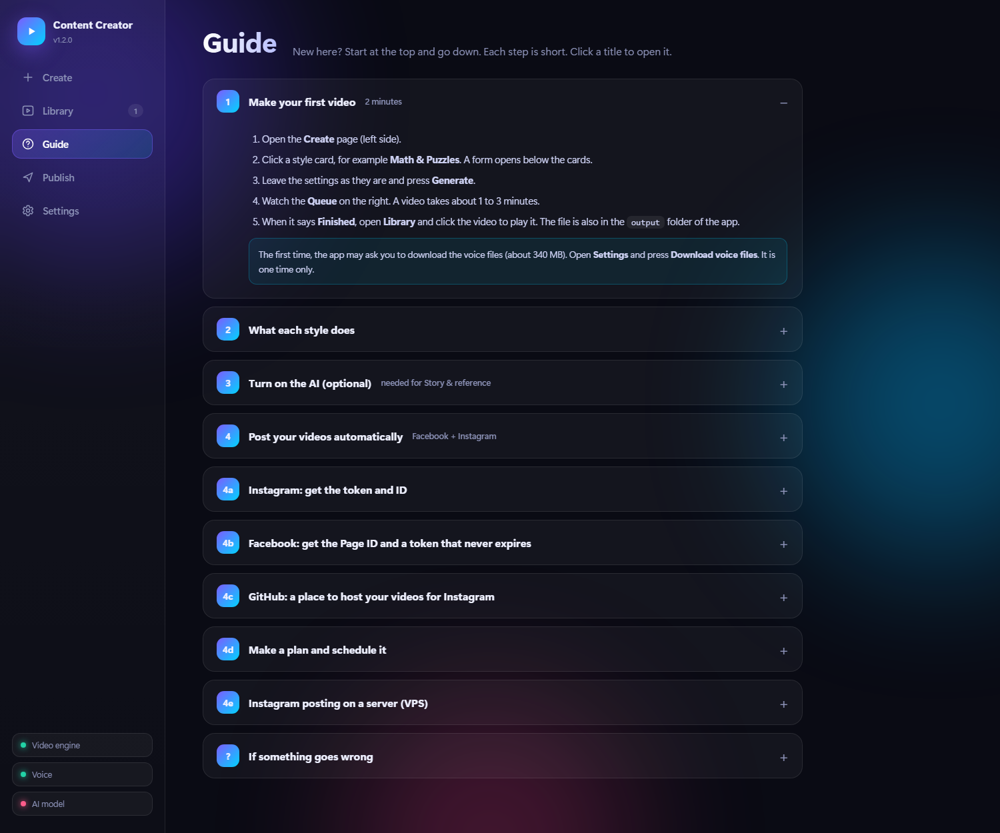

# AI Content Creator

Make short vertical videos on your own computer, for free: **math puzzles**, **satisfying ball simulations (ASMR)**, **music played by falling balls**,
**story / fact videos**, and new videos **inspired by a reference link**. Then schedule them on **Facebook and Instagram**.
No accounts needed to create, nothing is uploaded unless you publish.

- Modern web interface (opens in your browser, runs quietly in the background - no black window)
- Local AI through **Ollama** (writes problems and scripts, studies reference videos)
- Voice-over with **Kokoro** (offline), word timing with **Whisper** (offline), video with **ffmpeg** (bundled)
- Built-in step-by-step **Guide** for beginners, and **auto-update** with one click

## Install in one step (Windows)

Open **PowerShell** (Start menu, type `PowerShell`, Enter) and paste this single line:

```powershell
Set-ExecutionPolicy -Scope Process Bypass -Force; irm https://raw.githubusercontent.com/Shani0017/AI-Content-Creator/main/install.ps1 | iex
```

<sub>Prefer the classic **cmd** window? Paste this instead:</sub>

```
powershell -NoProfile -ExecutionPolicy Bypass -Command "irm https://raw.githubusercontent.com/Shani0017/AI-Content-Creator/main/install.ps1 | iex"
```

That one line does everything:

1. installs **Python 3.11** if you do not have it
2. downloads the app into `%USERPROFILE%\AI-Content-Creator`
3. installs all libraries (video, voice, AI, publishing)
4. downloads the voice files (about 340 MB)
5. installs **Ollama** and a small AI model (`llama3.2:3b`)
6. creates a **desktop shortcut** and starts the app

It takes 10 to 20 minutes the first time (about 3 GB of downloads). Next time, just double-click the **AI Content Creator** shortcut.
Updates later appear as a banner inside the app - one click.

<details><summary>Manual install (if you prefer)</summary>

1. Install **Python 3.11** from python.org (3.14 / 3.15 are too new for the speech packages).
2. Install **Ollama** from https://ollama.com and open it once.
3. Download this repo (green *Code* button > *Download ZIP*) and unzip it anywhere.
4. Double-click **`start.bat`**. The first run installs everything.
5. In the app: **Settings** > download the voice files and an AI model.
</details>

## Screenshots

<p align="center"></p>

| Library | Publish (Facebook + Instagram) |
|---|---|
|  |  |

| Step-by-step Guide | Settings |
|---|---|
|  |  |

| Music Balls | From a reference link |
|---|---|
|  |  |

**A generated math video** (frames from a real render, drawn from the problem's own numbers):

<p align="center"></p>

## Several ideas at once

On the Create page, **Several ideas at once** lets you write a list of ideas, choose a style for each (Math, Balls, Music, Story) and set
**how many reels to make for every idea**. One press queues all of them.

## What each style does

| Style | What you get |
|---|---|
| Math & Puzzles | Word problems explained step by step with their own animated drawing (a clock at the real time, N people shaking hands, a lake filling with lily pads, doors, trains...). Built-in templates are always correct; the AI option writes new ones and double-checks them. |
| Satisfying Balls | About 77 physics simulations. Every video is audited so collisions are real and it ends when everything is done. |
| Music Balls | Balls that play public-domain songs on xylophones, bells, glass bowls, drums, bricks and pads, each with its own look. |
| Story & Facts | You give a topic, the AI writes an original script, the app voices it with big keywords on screen. |
| From a reference link | Paste a link. The app studies its pace, colours, length and topic, then makes a **new, original** video in the closest style - automatically. |

## Publish to Facebook, Instagram and YouTube

Open the **Publish** page (and the **Guide** for the step-by-step version):

- Enter your Instagram / Facebook IDs and tokens and a public GitHub repo for hosting.
- Choose posts per day and days, press **Schedule**. Facebook posts are scheduled natively.
- Instagram has no scheduling for apps, so the app gives you a tiny **VPS package** that posts each reel at its time (Windows or Linux, Python only).
- **YouTube**: upload your videos to YouTube Studio as Private, then the app sets the title, description and publish time of each one (same times as Facebook/Instagram). Full steps are in the **Guide**.
- **Check posts** compares what was scheduled with what is live.

Tokens stay in `data/publish.json` on your computer and are never uploaded.

## No black window

The app starts in the background. Use the desktop shortcut the installer creates, or **Settings > Create desktop shortcut**.
Stop it with **Settings > Quit the app**. Logs are in `data/app.log`.

## Updating

When a new version is published you see a banner at the top of the app. Click **Update now**: your videos, models and settings are kept.
You can also press **Settings > Check now**. Or run the install line above again - it updates in place.

## Notes

- Only use reference links you have the right to study, and respect each platform's terms. The app does not copy the reference; it makes new content.
- Songs are public domain / traditional only.
- Windows is the supported platform (fonts and file dialogs).

## For the maintainer

Publish an update by committing to `main` and raising the number in `VERSION` (and adding a note to the top of `CHANGELOG.md`).
Every installed copy checks `VERSION` on GitHub and offers the update.
