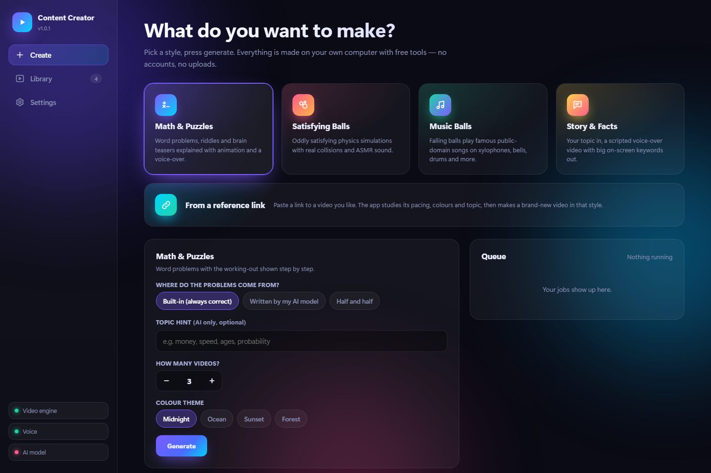
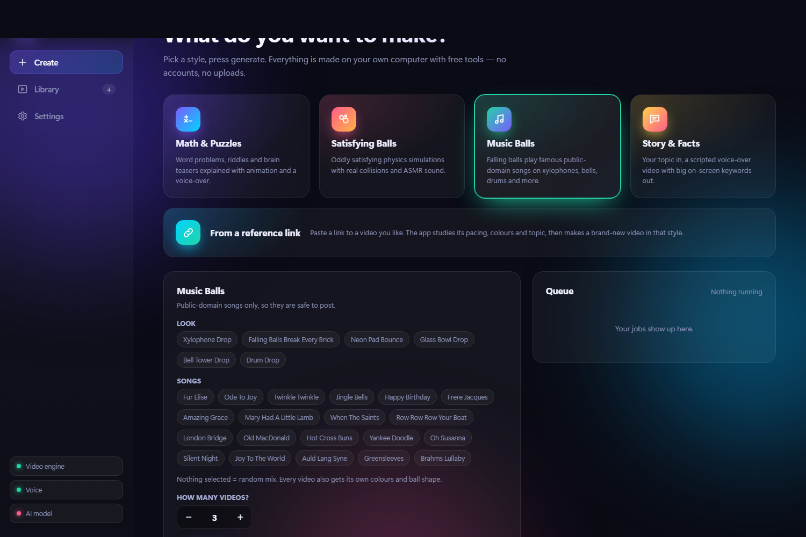
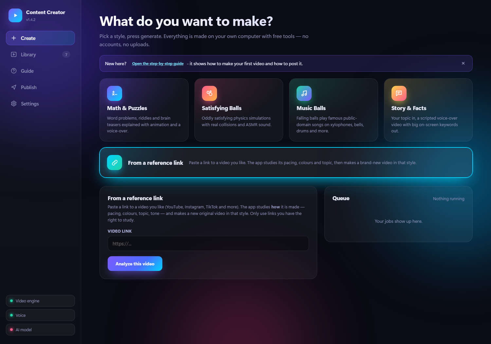
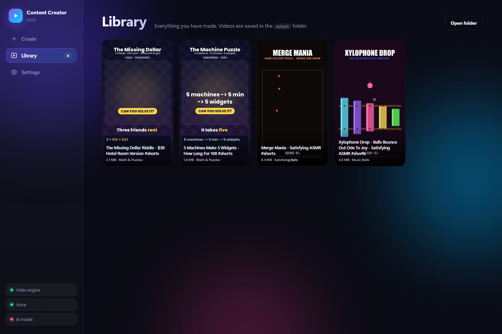
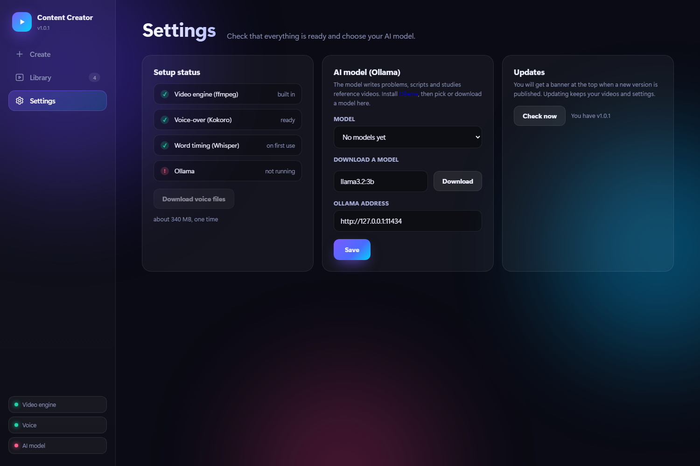
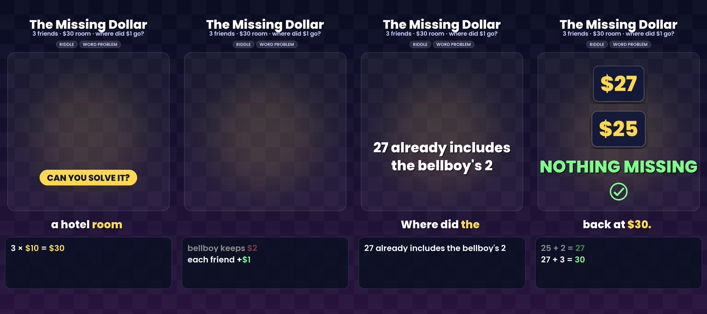

# AI Content Creator

Make short vertical videos on your own computer, for free: **math puzzles**, **satisfying ball simulations**, **music played by falling balls**,
**story/fact videos**, and new videos **inspired by a reference link**. No accounts, no uploads - everything runs locally.

- Beautiful web UI (opens in your browser) - not a plain desktop window
- Local AI through **Ollama** (writes problems and scripts, studies reference videos)
- Voice-over with **Kokoro** (offline), timing with **Whisper** (offline), video with **ffmpeg** (bundled)
- Built-in **auto-update**: a banner appears when a new version is published; one click updates and keeps your videos

## Screenshots

<p align="center"></p>

| Music Balls | From a reference link |
|---|---|
|  |  |

| Library | Settings and AI model |
|---|---|
|  |  |

**A generated math video** (frames from a real render):

<p align="center"></p>

## Install (Windows) - one command

Open **cmd** (Windows key, type `cmd`, Enter) and paste this single line:

```
powershell -NoProfile -ExecutionPolicy Bypass -Command "irm https://raw.githubusercontent.com/Shani0017/AI-Content-Creator/main/install.ps1 | iex"
```

It installs Python 3.11 (if needed), the app, the video / voice / AI libraries, the voice files, Ollama and a small AI model, then creates a
desktop shortcut and starts the app. Takes 10-20 minutes the first time (about 3 GB of downloads). Next time just double-click the shortcut.

### Manual install (if you prefer)

1. Install **Python 3.11** from python.org (3.14 / 3.15 are too new for the speech packages).
2. Install **Ollama** from https://ollama.com and open it once.
3. Download this repo (green *Code* button > *Download ZIP*), unzip it anywhere.
4. Double-click **`start.bat`**. The first run installs everything (a few minutes).
5. In the app: **Settings** > download the voice files (about 340 MB) and an AI model (for example `llama3.2:3b`).

That is it. Pick a style on the **Create** page and press **Generate**. Finished videos appear in **Library** and in the `output` folder.

## What each style does

| Style | What you get |
|---|---|
| Math & Puzzles | Word problems explained step by step. Built-in templates are always correct; the AI option writes new ones and double-checks them. |
| Satisfying Balls | ~80 physics simulations. Every video is audited so collisions are real and it ends when everything is done. |
| Music Balls | Balls that play public-domain songs on xylophones, bells, glass bowls, drums, bricks and pads - each with its own look. |
| Story & Facts | You give a topic, the AI writes an original script, the app voices it with big keywords on screen. |
| From a reference link | Paste a link. The app downloads it only to *study* it (pacing, colours, topic, tone) and then makes a **new, original** video in that style. |

## Publish (Facebook + Instagram)

New to this? Open the **Guide** page in the app: it explains every step in plain words, from your first video to posting on Facebook and Instagram.

Open the **Publish** page, enter your Instagram / Facebook IDs and tokens and a public GitHub repo for hosting, choose posts per day and days, and press *Schedule*.
Facebook posts are scheduled natively. Instagram is posted by a tiny script on your server: download the VPS package from the same page (Windows or Linux, Python only).
Tokens stay in `data/publish.json` on your computer and are never uploaded.

## Updating

When the maintainer publishes a new version you see a banner at the top of the app. Click **Update now** - your videos, models and settings are kept.
You can also press *Check now* in Settings.

## Notes

- Only use reference links you have the right to study, and respect each platform's terms. The app does not copy the reference; it makes new content.
- Songs are public domain / traditional only.
- Windows is the supported platform (fonts and file dialogs).

## For the maintainer

Publish an update by committing to `main` and raising the number in `VERSION` (and adding a note to the top of `CHANGELOG.md`).
Every installed copy checks `VERSION` on GitHub and offers the update.
